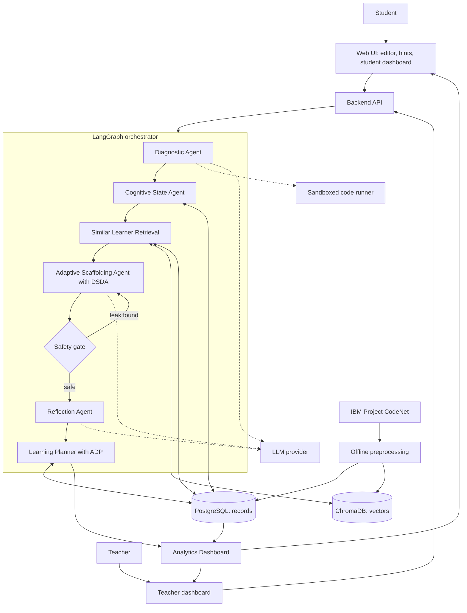
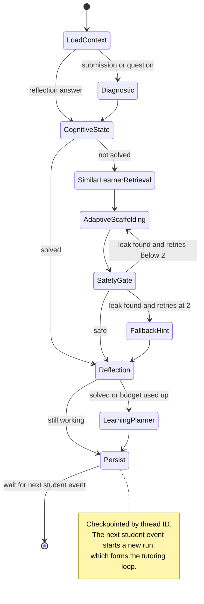
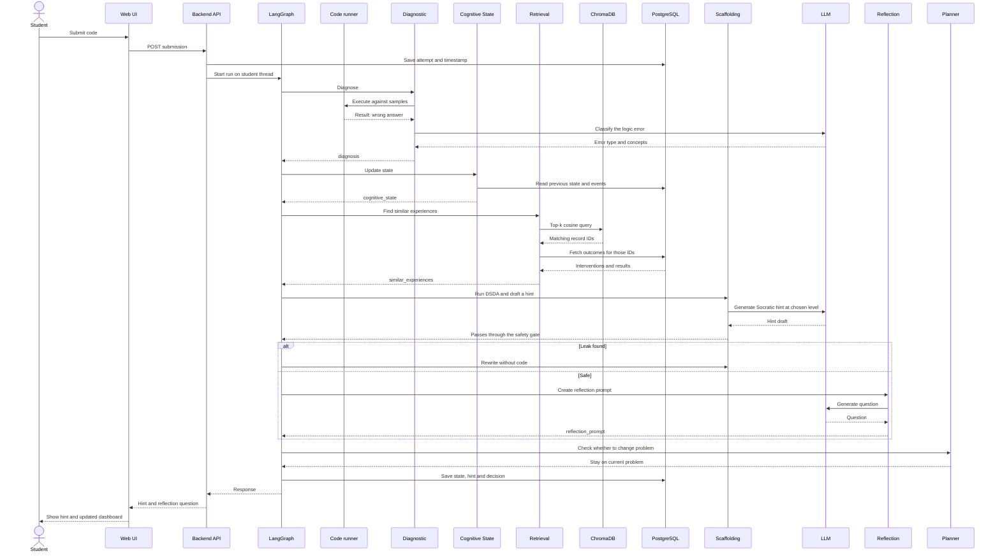
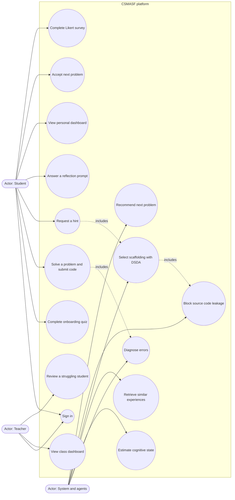
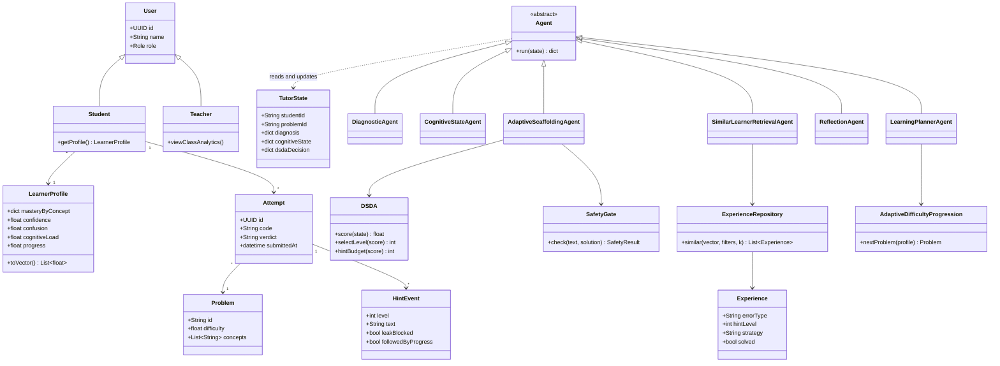
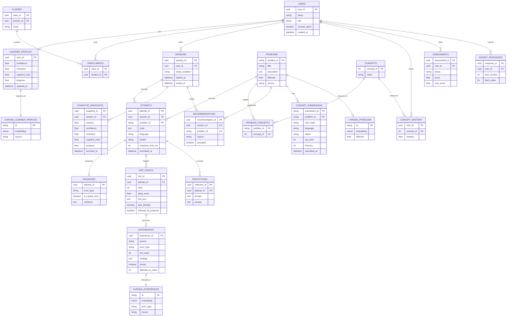
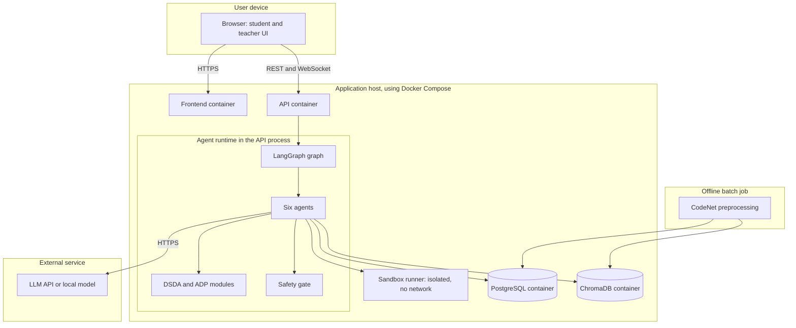
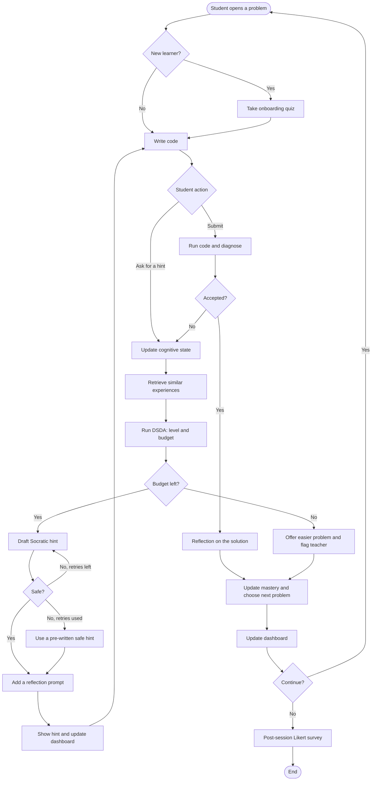

# CSMASF System Analysis

**Project:** Adaptive Multi-Agent AI Tutoring System for Personalized Programming Education
**Source analysed:** `projectphase.pdf` (10 pages, course 23CSE498, Project Phase II, 2026)
**Framework:** Cognitive-State Guided Multi-Agent Adaptive Scaffolding Framework (CSMASF)

## Contents

1. [Project overview](#1-project-overview)
2. [Complete feature list](#2-complete-feature-list)
3. [Agent-by-agent specification](#3-agent-by-agent-specification)
4. [System flow and architecture](#4-system-flow-and-architecture)
5. [Model and view documentation](#5-model-and-view-documentation)
6. [Data and algorithms](#6-data-and-algorithms)
7. [Evaluation plan](#7-evaluation-plan)
8. [Literature positioning](#8-literature-positioning)
9. [Gaps, risks and open questions](#9-gaps-risks-and-open-questions)
10. [Implementation roadmap](#10-implementation-roadmap)
11. [Plain-language summary and viva Q&A](#11-plain-language-summary-and-viva-qa)

## How to read this document

| Label | Meaning |
|---|---|
| [STATED] | Written in the report. Followed by a report section and page, such as (§5.1, p.4). |
| [INFERRED] | Reasonably implied by the report. The reason is given. |
| [MISSING] | Not specified in the report. Treated as an open question. |
| [SUGGESTION] | My proposal to fill a gap. It is not in the report and is not a team decision. |
| [EXTERNAL] | A fact from outside the report: the public IBM Project CodeNet repository, checked on 8 Nov 2026. Used only where it changes a design decision. |

**References:** "§" always means a section of the report, and "Section" means a section of this document.

The report is short and is headed "Initial Project Idea Submission". It sets out the idea, but it is not a specification. Most agent inputs, outputs and algorithms are therefore [MISSING], and the suggestions in this document are starting points for the team to accept or reject.

### The seven findings to read first

| # | Finding | Why it matters | Where |
|---|---|---|---|
| 1 | The report calls the architecture **sequential** (§5.1, p.4) and also **cyclic** (§6.3, p.8). Its only diagram has no loop. | "Cyclic" is a claimed contribution, yet no loop or stop condition is defined. | Section 4.2 |
| 2 | **DSDA has no formula, thresholds or defined levels**, and its inputs and outputs differ between pages. | DSDA is the first claimed contribution and cannot be built or defended as written. | Section 6.3 |
| 3 | **CodeNet has no hints, tutoring dialogue or confidence data** [EXTERNAL]. | "Past successful learning tools" cannot be retrieved from CodeNet alone. Retrieval starts with nothing to return unless the team designs around this. | Section 6.1 |
| 4 | **Objective 5 tests on datasets, but the metrics need live students.** Likert surveys and before/after tasks cannot be run on CodeNet. | There is no participant plan, control group or ethics step. | Section 7 |
| 5 | The cognitive state has **three different dimension lists** across the report. | The state schema, the dashboards and the profile vector all depend on this list. | Section 3.2 |
| 6 | **The core stack is unnamed**: LLM, backend, frontend, embedding model and code execution. | These must be decided before implementation starts. | Section 9 |
| 7 | The novelty statement refers to existing multi-agent educational systems, but **none of the 9 surveyed papers is presented as a multi-agent tutor**. | An examiner can challenge this directly. | Section 8.3 |

---

## 1. Project overview

### 1.1 Project details

| Item | Detail | Label |
|---|---|---|
| Course and phase | 23CSE498, Project Phase II, 2026, B.Tech CSE | [STATED] (cover, p.1) |
| Institution | Amrita School of Computing, Amritapuri Campus, Dept. of CSE | [STATED] (cover, p.1) |
| Team | Kataru Reddy Eswar, Bharath Bommineni, Chimmili Lokesh, Ramisetti Gowtham Tej | [STATED] (cover, p.1) |
| Guide | Ms. Anju Sukumar | [STATED] (cover, p.1) |
| Compliance limit | Similarity index below 15% and AI-generated content score below 20%, verified with Turnitin | [STATED] (§9, p.10) |

### 1.2 Motivation, problem, gap and novelty

| Topic | What the report says | Label |
|---|---|---|
| **Motivation** | ChatGPT, Gemini and Claude answer instantly, but they do not attend to the learning process. They cannot tell whether a student is lost, confident or progressing, so everyone receives the same help. | [STATED] (§2.1, p.2) |
| **Educational basis** | Learning becomes effective through scaffolding, differentiated aid and constant feedback. Existing tutoring systems personalize very little. | [STATED] (§2.1, p.2) |
| **Vision** | A tutor that follows what students do, estimates their cognition level and adapts the amount of help, using collaborating agents. | [STATED] (§2.1, p.2) |
| **Role of teachers** | The system is an intelligent helper and is not meant to replace teachers. | [STATED] (§2.1, p.2) |
| **Problem: LLM tutors** | They act mostly as question-and-answer tools, with no continuous learner model. Beginners get explanations that are too complex, and advanced students get help they do not need. | [STATED] (§2.2, p.2) |
| **Problem: classic ITS** | They rely on coded rules and fixed learner models, which do not suit varied programming ideas and learners. | [STATED] (§2.2, p.2) |
| **Need** | A tutor that understands the learner's current cognitive state, diagnoses difficulties during instruction and gives individualized support. | [STATED] (§2.2, p.2) |
| **Research gap** | Current systems focus on performance forecasting, conversational help or collaborating agents. They do not combine cognitive state modelling, adaptive scaffolding and personalized learner retrieval in a single approach. | [STATED] (§6.2, p.7) |
| **Novelty** | CSMASF integrates cognitive state modelling, similar learner retrieval and dynamic scaffolding. | [STATED] (§6.2, p.7) |

### 1.3 The four claimed contributions

| # | Contribution | What the report says | What is left undefined |
|---|---|---|---|
| 1 | **Dynamic Scaffolding Decision Algorithm (DSDA)** | Computes effective assistance given current cognitive load, and determines the optimal number of tips. [STATED] (§6.3, p.8) | Formula, weights, levels, and the meaning of "optimal". [MISSING] |
| 2 | **Hybrid Experience Retrieval Architecture** | Uses PostgreSQL and ChromaDB, with Cosine Similarity, to recover past successful learning tools. [STATED] (§6.3, p.8) | What a "learning tool" is, what each database stores, and what counts as "successful". [MISSING] |
| 3 | **Adaptive Difficulty Progression Module** | Predicts the next task from the learner's mastery and progress. [STATED] (§6.3, p.8) | Difficulty scale and selection rule. [MISSING] |
| 4 | **Cyclic Graph Pedagogical Orchestration** | Organizes learning through six specialized agents, manages interaction safely to prevent direct source code leakage, and promotes Socratic methods. [STATED] (§6.3, p.8) | Cycles, stop conditions and the leakage-prevention mechanism. [MISSING] |

### 1.4 The five objectives

| # | Objective as stated | In plain English | Source |
|---|---|---|---|
| 1 | Build an adaptive tutor as multiple collaborating agents, not one conversational model. | Use a team of specialised AI agents, not one chatbot. | [STATED] (§3, p.2) |
| 2 | Build cognitive state modelling that continuously estimates mastery, confidence, confusion, cognitive load and learning progress from behaviour and interaction. | Keep a live estimate of how each student is doing. | [STATED] (§3, p.2) |
| 3 | Build an engine that retrieves similar learners using vector cosine similarity over multidimensional profiles. | Find past students who resemble this one, and learn from them. | [STATED] (§3, p.2) |
| 4 | Design a scoring algorithm that selects the scaffolding level from mastery, confidence, hint history and response time. | Calculate how much help this student should get right now. | [STATED] (§3, p.3) |
| 5 | Test the framework's effectiveness on programming datasets. | Prove that it works. | [STATED] (§3, p.3) |

### 1.5 Expected deliverables

| # | Deliverable | Source |
|---|---|---|
| 1 | Web-based adaptive multi-agent tutoring platform with cognitive state prediction and dynamic scaffolding | [STATED] (§5, p.3) |
| 2 | Cognitive State Modelling unit that continuously assesses competency, assurance, perplexity, load and misunderstanding patterns | [STATED] (§5, p.3) |
| 3 | Hybrid Similar Learner Retrieval that recommends interventions from behavioural embedding similarity, with k-NN given as an example | [STATED] (§5, p.3) |
| 4 | Multi-agent system of the six named agents, connected through LangGraph | [STATED] (§5, p.3) |
| 5 | Interactive student and teacher dashboards showing topic mastery, process success, hint usage, cognitive state changes and study recommendations | [STATED] (§5, p.3) |

---

## 2. Complete feature list

The report gives no priorities, so **the Priority column is my [SUGGESTION]**. "Must" means the claimed contributions or deliverables fail without it.

### 2.1 Stated features

| ID | Feature | Description | Source | Status | Priority |
|---|---|---|---|---|---|
| F01 | Web-based platform | Tutoring delivered through a web application | §5, p.3 | STATED | Must |
| F02 | Student interaction intake | Entry point of the pipeline. The form of input is not specified. | §5.1, p.4 | STATED | Must |
| F03 | Diagnostic Agent | Parses syntax and logic errors | §5.1, p.4 | STATED | Must |
| F04 | Cognitive State Agent | Estimates confusion, mastery and load | §5.1, p.4 | STATED | Must |
| F05 | Similar Learner Retrieval Agent | Cosine similarity on historical profiles | §5.1, p.4 | STATED | Must |
| F06 | Adaptive Scaffolding Agent | Executes DSDA | §5.1, p.4 | STATED | Must |
| F07 | Reflection Agent | Prompts metacognitive reasoning | §5.1, p.4 | STATED | Must |
| F08 | Learning Planner Agent | Recommends the next problem | §5.1, p.4 | STATED | Must |
| F09 | LangGraph orchestration | Connects the six agents | §5, p.3 | STATED | Must |
| F10 | Cyclic graph orchestration | Organizes the learning process as a cyclic graph | §6.3, p.8 | STATED | Must |
| F11 | Mastery estimation | Continuous estimate per learner | §3, p.2 | STATED | Must |
| F12 | Confidence estimation | Continuous estimate per learner | §3, p.2 | STATED | Must |
| F13 | Confusion estimation | Continuous estimate per learner | §3, p.2 | STATED | Must |
| F14 | Cognitive load estimation | Continuous estimate per learner | §3, p.2 | STATED | Must |
| F15 | Learning progress tracking | Continuous estimate per learner | §3, p.2 | STATED | Must |
| F16 | Misunderstanding pattern tracking | Part of the Cognitive State Modelling unit | §5, p.3 | STATED | Should |
| F17 | Multidimensional learner profiles | Vector profile for each learner | §3, p.2 | STATED | Must |
| F18 | Cosine similarity search | Matching method for retrieval | §3, p.2; §6.3, p.8 | STATED | Must |
| F19 | k-NN retrieval | Given as an example ("for instance") | §5, p.3 | STATED | Should |
| F20 | Hybrid storage | PostgreSQL plus ChromaDB | §6.3, p.8 | STATED | Must |
| F21 | Intervention recommendation | Recommendations based on behavioural similarity | §5, p.3 | STATED | Must |
| F22 | Recovery of past successful learning tools | Output of hybrid retrieval | §6.3, p.8 | STATED | Must |
| F23 | DSDA scoring | Scores the learner's need for help | §3, p.3; §6.3, p.8 | STATED | Must |
| F24 | Scaffolding level selection | Chooses an appropriate level | §3, p.3 | STATED | Must |
| F25 | Hint quantity control | Determines the optimal number of tips | §6.3, p.8 | STATED | Must |
| F26 | Hint history input | Used by the scoring algorithm | §3, p.3 | STATED | Must |
| F27 | Response time input | Used by the scoring algorithm | §3, p.3 | STATED | Must |
| F28 | Reflection prompts | Metacognitive questions to the student | §5.1, p.4 | STATED | Must |
| F29 | Adaptive Difficulty Progression | Predicts the next task from mastery and progress | §6.3, p.8 | STATED | Must |
| F30 | Student dashboard | Mastery, progress, hints, cognitive state, recommendations | §5, p.3 | STATED | Must |
| F31 | Teacher dashboard | Interactive dashboard for teachers; contents are not split by role | §5, p.3 | STATED | Must |
| F32 | Analytics Dashboard as pipeline end | Final stage of the pipeline | §5.1, p.4 | STATED | Must |
| F33 | Source code leakage prevention | Prevents direct source code leakage | §6.3, p.8 | STATED | Must |
| F34 | Socratic approach | Promotes Socratic learning methods | §6.3, p.8 | STATED | Must |
| F35 | CodeNet problem data | Programming questions from CodeNet | §4, p.3 | STATED | Must |
| F36 | Accepted-solution data | Acceptable solutions from CodeNet | §4, p.3 | STATED | Should |
| F37 | Misconception analysis | Uses rejected submissions to study misconceptions, errors and approaches | §4, p.3 | STATED | Should |
| F38 | Learner behaviour analysis | Listed as a CodeNet data element | §4, p.3 | STATED | Should |
| F39 | Before/after task comparison | Basis for Learning Gain | §5.2, p.4 | STATED | Must |
| F40 | Post-session Likert survey | Basis for Student Satisfaction | §5.2, p.4 | STATED | Must |

### 2.2 Inferred features

| ID | Feature | Why it is implied | Status | Priority |
|---|---|---|---|---|
| F41 | User accounts and roles | Separate student and teacher dashboards (§5, p.3) need identified users. | INFERRED | Must |
| F42 | LLM integration | Hints, Socratic prompting and the leakage concern (§6.3, p.8) all assume generated text. The survey also centres on LLMs. No LLM is named. | INFERRED | Must |
| F43 | Code editor and submission UI | Agents parse code errors, so students must be able to submit code. | INFERRED | Must |
| F44 | Code execution or judging | The Diagnostic Agent detects **logic** errors (§5.1, p.4), which generally requires running code or comparing it with tests. | INFERRED | Must |
| F45 | Event logging | Response time, hint history and every §5.2 metric need timestamped events. | INFERRED | Must |
| F46 | Persistent learner model | The report criticises tools with no continuous model (§2.2, p.2), so state must survive between sessions. | INFERRED | Must |
| F47 | Output safety check | Preventing leakage (§6.3, p.8) needs an actual enforcement step. | INFERRED | Must |
| F48 | Problem bank with difficulty values | Difficulty progression (§6.3, p.8) needs comparable difficulty values. | INFERRED | Must |
| F49 | Vector embedding pipeline | ChromaDB and "behavioural embedding" (§5, p.3) require vectors to be generated. | INFERRED | Must |
| F50 | Class-level teacher analytics | A teacher dashboard is of little use without a view across students. | INFERRED | Should |

### 2.3 Missing features worth considering ([SUGGESTION])

| ID | Feature | Why | Priority |
|---|---|---|---|
| F51 | Cold-start onboarding | A new learner has no profile to match. A short diagnostic quiz solves this. | Must |
| F52 | Sandboxed code runner | Running untrusted student code safely | Must |
| F53 | Consent and data export/delete | Needed for any study with real students | Must |
| F54 | Student "ask for a hint" control and self-report | Provides a direct confidence signal and makes hint use measurable | Should |
| F55 | Teacher override and alerts | Supports the "does not replace teachers" position (§2.1, p.2) | Nice |
| F56 | Agent trace viewer | Makes debugging and the viva demo much easier | Nice |

---

## 3. Agent-by-agent specification

**Reading note:** for each agent, the report gives only a name and a one-line role in §5.1. Everything else below is marked accordingly.

### 3.1 Diagnostic Agent

| Aspect | Specification | Label |
|---|---|---|
| **Purpose** | Parses syntax and logic errors. | [STATED] (§5.1, p.4) |
| **Inputs** | The student's interaction, as first pipeline stage. Likely code, problem ID and language. | [INFERRED] from pipeline position |
| **Outputs** | Error diagnosis passed to the Cognitive State Agent. | [INFERRED] from pipeline order |
| **Internal logic** | Not described. | [MISSING] |
| **Depends on** | Student Interaction (upstream). Cognitive State Agent (downstream). | [STATED] (§5.1, p.4) |
| **Suggested logic** | (1) Compile or parse for syntax errors. (2) Run against the problem's samples in a sandbox. (3) Ask the LLM to classify the logic error from a fixed list. (4) Output structured JSON. | [SUGGESTION] |
| **Suggested output** | `{verdict, error_type, concept_tags[], evidence, is_repeat_error}` | [SUGGESTION] |

**Unclear points**
- Can the agent handle a chat question with no code? "Student Interaction" does not say.
- Which languages are supported? CodeNet has 55, but nothing says which ones the tutor will accept.
- How are logic errors found? Parsing alone cannot find them, and [EXTERNAL] CodeNet states that sample input and output are included only where they could be extracted, so test coverage per problem must be checked.

### 3.2 Cognitive State Agent

| Aspect | Specification | Label |
|---|---|---|
| **Purpose** | Estimates confusion, mastery and load. | [STATED] (§5.1, p.4) |
| **Inputs** | Student behaviour and interaction with the tutors. | [STATED] (§3, p.2) |
| **Outputs** | Estimates of the state dimensions. | [STATED] (§3, p.2) |
| **Internal logic** | Not described. The report only says "continuously estimates". | [MISSING] |
| **Depends on** | Diagnostic Agent (upstream). Similar Learner Retrieval (downstream). | [STATED] (§5.1, p.4) |

**The dimension list changes across the report:**

| Place | Dimensions listed |
|---|---|
| Objective 2 (§3, p.2) | mastery, confidence, confusion, cognitive load, learning progress |
| Deliverable 2 (§5, p.3) | competency, assurance, perplexity, load, misunderstanding patterns |
| Pipeline (§5.1, p.4) | confusion, mastery, load |

[INFERRED] Competency means mastery, assurance means confidence, and perplexity means confusion. These look like wording variations. This leaves **six dimensions** in total: mastery, confidence, confusion, cognitive load, progress and misunderstanding patterns.

**Suggested estimators.** Without sensors, these are all behavioural proxies and should be described as such. [SUGGESTION]

| Dimension | Possible signals | Possible method | Range |
|---|---|---|---|
| Mastery (per concept) | Correct attempts, hints used before success | Bayesian Knowledge Tracing at first. Deep Knowledge Tracing [1] as a stretch goal. | 0 to 1 |
| Confidence | Self-rating, time before first hint request, submit frequency | Short self-report, blended with behaviour | 0 to 1 |
| Confusion | Repeated same error, contradictory edits, text cues in questions | Rule score plus LLM classification | 0 to 1 |
| Cognitive load | Response time against the learner's baseline, long pauses, number of concepts involved | Rule score, checked with a post-task self-rating | 0 to 1 |
| Progress | Tests passed, reduction in error severity, topics completed | Direct calculation | 0 to 1 |
| Misunderstanding patterns | Recurring `error_type` and concept tags | Counts with time decay | Categorical |

**Unclear points**
- Is the state per learner, or per learner and concept? Mastery is much more useful per concept.
- Are these values LLM judgements, statistical estimates, or a mix?
- How will the estimates be validated? There is no ground truth for confusion or load.

### 3.3 Similar Learner Retrieval Agent

| Aspect | Specification | Label |
|---|---|---|
| **Purpose** | Finds similar past learners using cosine similarity on historical profiles. | [STATED] (§5.1, p.4) |
| **Inputs** | Multidimensional learner profile. | [STATED] (§3, p.2) |
| **Outputs** | Recommended educational interventions, or recovered past successful learning tools. | [STATED] (§5, p.3; §6.3, p.8) |
| **Internal logic** | Cosine similarity over vectors, with k-NN as an example, using PostgreSQL and ChromaDB. | [STATED] (§5, p.3; §6.3, p.8) |
| **Depends on** | Cognitive State Agent (upstream). Adaptive Scaffolding Agent (downstream). | [STATED] (§5.1, p.4) |

**Unclear points**
- "Hybrid" has two meanings in the report: behavioural embedding similarity (§5, p.3) and two databases (§6.3, p.8).
- "Interventions" and "learning tools" are not defined. I recommend one concrete record type, set out in Section 4.4.
- Historical profiles have no stated source. See Section 6.1 for why CodeNet alone cannot supply them.
- This agent may not need an LLM at all, and the report does not say. Using plain code here would be cheaper and more reproducible.

### 3.4 Adaptive Scaffolding Agent

| Aspect | Specification | Label |
|---|---|---|
| **Purpose** | Executes DSDA to decide on the assistance given. | [STATED] (§5.1, p.4) |
| **Inputs** | Mastery, confidence, hint history and response time. | [STATED] (§3, p.3) |
| **Inputs (also)** | Current cognitive load. | [STATED] (§6.3, p.8) |
| **Inputs (also)** | Retrieval output, because the agent follows retrieval in the pipeline. | [INFERRED] from §5.1 order |
| **Outputs** | A scaffolding level (§3, p.3) and an optimal number of tips (§6.3, p.8). | [STATED] |
| **Internal logic** | A "scoring algorithm". No formula is given. | [STATED] name only; formula [MISSING] |
| **Safety** | Must not leak source code, and should use Socratic methods. | [STATED] (§6.3, p.8) |
| **Depends on** | Similar Learner Retrieval (upstream). Reflection Agent (downstream). | [STATED] (§5.1, p.4) |

**Unclear points**
- Objective 4 does not use the name "DSDA". [INFERRED] It is the same algorithm, since both select assistance from cognitive state.
- The report does not define the scaffolding levels or say how many there are.
- "Optimal number of tips" has no definition of what is being optimised.
- A concrete DSDA proposal is in Section 6.3.

### 3.5 Reflection Agent

| Aspect | Specification | Label |
|---|---|---|
| **Purpose** | Prompts metacognitive reasoning. | [STATED] (§5.1, p.4) |
| **Inputs** | Output of the Adaptive Scaffolding Agent. | [INFERRED] from §5.1 order |
| **Outputs** | A reflection prompt to the student. | [INFERRED] from "prompts" |
| **Internal logic** | Not described. | [MISSING] |
| **Depends on** | Adaptive Scaffolding Agent (upstream). Learning Planner (downstream). | [STATED] (§5.1, p.4) |

**Suggested prompt types** [SUGGESTION]

| Trigger | Example prompt |
|---|---|
| Wrong answer | "What did you expect this loop to do on its last pass?" |
| After a hint | "In your own words, what does that hint change about your approach?" |
| Accepted solution | "Why does your solution handle the empty-input case?" |
| Repeated error | "This error has come up before. What is similar about both situations?" |

**Unclear points**
- Does the student's answer get evaluated, and does it feed back into the cognitive state? If so, that is a natural **cycle** in the graph.
- Does reflection run on every interaction? Doing so after each attempt could frustrate students and add to their load.

### 3.6 Learning Planner Agent

| Aspect | Specification | Label |
|---|---|---|
| **Purpose** | Recommends the next problem via Adaptive Difficulty Progression. | [STATED] (§5.1, p.4) |
| **Inputs** | Mastery achieved and progress. | [STATED] (§6.3, p.8) |
| **Outputs** | Next task, and study recommendations shown on dashboards. | [STATED] (§6.3, p.8; §5, p.3) |
| **Internal logic** | "Predicting" the next task. The method is not described. | [MISSING] |
| **Depends on** | Reflection Agent (upstream). Analytics Dashboard (downstream). | [STATED] (§5.1, p.4) |

**Unclear points**
- Does it run after every attempt, or only after a problem is finished or abandoned?
- Can a teacher assign or override problems?
- Does "progress" come from the Cognitive State Agent or get calculated separately?
- A concrete progression rule is in Section 6.4.

### 3.7 Agent summary

| Agent | Needs LLM? [SUGGESTION] | Reads | Writes to shared state |
|---|---|---|---|
| Diagnostic | Partly, for logic errors | Code, problem, test results | `diagnosis` |
| Cognitive State | Optional, mostly rules and statistics | `diagnosis`, events, previous state | `cognitive_state` |
| Similar Learner Retrieval | No | `cognitive_state`, `diagnosis` | `similar_experiences` |
| Adaptive Scaffolding | DSDA: no. Hint wording: yes | State, experiences, hint history | `dsda_decision`, `hint_draft` |
| Reflection | Yes | `hint_draft`, `diagnosis` | `reflection_prompt` |
| Learning Planner | No, or light use for explanations | Mastery, progress, problem bank | `next_problem` |

---

## 4. System flow and architecture

### 4.1 End-to-end pipeline

The pipeline order is [STATED] (§5.1, p.4). The Output and Example columns are [SUGGESTION], using an invented student and invented values.

| Step | Stage | Report's description | Output passed on | Example |
|---|---|---|---|---|
| 1 | Student Interaction | Entry point | Code, problem ID, timestamps | Student submits a Python loop |
| 2 | Diagnostic Agent | Parses syntax and logic errors | Structured diagnosis | Logic error: off-by-one |
| 3 | Cognitive State Agent | Estimates confusion, mastery, load | Updated state vector | Mastery 0.35, confusion 0.70 |
| 4 | Similar Learner Retrieval | Cosine similarity on historical profiles | Top-k experiences | 5 learners, 3 recovered after a boundary-check nudge |
| 5 | Adaptive Scaffolding Agent | Executes DSDA | Level, tip count, hint text | Level 2: "Check the last value your loop reaches" |
| 6 | Reflection Agent | Prompts metacognitive reasoning | Reflection question | "What should happen on the final pass?" |
| 7 | Learning Planner | Recommends next problem via ADP | Next problem or "keep trying" | Stay on this problem |
| 8 | Analytics Dashboard | End of pipeline | Updated charts | Hint count rises and mastery is updated |

### 4.2 What "cyclic graph orchestration" means here

**What the report actually says:**

| Statement | Source |
|---|---|
| Agents are interconnected via the LangGraph platform. | [STATED] (§5, p.3) |
| The approach is based on a collective graph of intelligent agents. | [STATED] (§5.1, p.4) |
| Interactions are processed **sequentially** to ensure pedagogical security and adequate support. | [STATED] (§5.1, p.4) |
| The orchestration is a **cyclic graph** with six agents that ensures safe interaction management. | [STATED] (§6.3, p.8) |
| Nodes, shared state, conditional edges, loops, stop conditions | [MISSING] |

**The contradiction and how to resolve it.** A straight line is not a cycle. [INFERRED] The two statements can be reconciled like this: agents run in sequence *within* one pass, and learning repeats *across* passes as a student works on a problem. Whether the loop exists inside the graph or only through the student resubmitting must be decided, because a claimed contribution rests on it. I recommend having both, as described below.

**LangGraph concepts applied to this project** [SUGGESTION]

| Concept | General meaning | In CSMASF |
|---|---|---|
| **Node** | A function that reads and updates shared state | Each of the six agents, plus non-agent utility steps (load context, safety gate, persist) |
| **Edge** | A fixed transition | Diagnostic to Cognitive State, and so on |
| **Conditional edge** | A transition chosen by a function | Solved or not solved; safety pass or fail |
| **Shared state** | One typed object that all nodes read and update | `TutorState`, shown below |
| **Checkpointer** | Saves state between runs | Resumes a student's session, keyed by a thread ID |
| **Cycle** | An edge leading back to an earlier node | Three loops, listed below |
| **Stop condition** | When to finish | Listed below |

**Keeping the safety gate as a utility step** means the report's claim of "six specialized AI agents" stays accurate.

**Proposed loops** [SUGGESTION]

| Loop | Path | Purpose | Where it runs |
|---|---|---|---|
| **A. Safety loop** | Safety gate back to Scaffolding | Rewrites a hint that leaks code | Inside one graph run |
| **B. Tutoring loop** | END, student resubmits, then Diagnostic | Attempt, hint, attempt | Across runs on the same thread |
| **C. Reflection loop** | Student's reflection answer back to Cognitive State | Reflection updates the learner's state | Across runs on the same thread |

**Proposed stop conditions** [SUGGESTION]

| Scope | Condition | Result |
|---|---|---|
| Safety loop | Hint passes the check | Continue to Reflection |
| Safety loop | 2 failed rewrites | Use a pre-written safe hint and log the event |
| Graph run | Hint and reflection delivered | End the run and wait for the student |
| Graph run | LangGraph recursion limit reached | Fail safely and log the event |
| Problem | Accepted verdict | Run the Planner and offer the next problem |
| Problem | Hint budget used up, or attempt limit reached | Offer an easier problem and flag it for the teacher |
| Session | Student exits or times out | Save state and show the survey if the session is complete |

**Suggested shared state** [SUGGESTION]

```python
from typing import Literal, Optional, TypedDict

class TutorState(TypedDict):
    # Identity
    student_id: str
    session_id: str
    problem_id: str
    # Input
    event_type: Literal["submission", "question", "hint_request", "reflection_answer"]
    code: Optional[str]
    language: Optional[str]
    message: Optional[str]
    # Agent outputs
    diagnosis: Optional[dict]            # Diagnostic
    cognitive_state: dict                # Cognitive State
    similar_experiences: list[dict]      # Retrieval
    dsda_decision: Optional[dict]        # Scaffolding: score, level, budget
    hint_draft: Optional[str]            # Scaffolding
    safety_retries: int                  # Safety gate
    reflection_prompt: Optional[str]     # Reflection
    next_problem: Optional[str]          # Planner
```

### 4.3 Diagrams

**(a) Architecture and flow.** The pipeline order, PostgreSQL, ChromaDB and dashboards are [STATED]. The UI, API, LLM, sandbox and safety gate are [INFERRED] or [SUGGESTION].



**(b) LangGraph state graph.** The agent order is [STATED]. The utility nodes, conditions and loops are [SUGGESTION].



**(c) Sequence of one student submission.** This shows a wrong answer followed by a hint. The order of agents is [STATED]. The detailed messages are [SUGGESTION].



### 4.4 Data flow and the hybrid retrieval design

**What the report states:** two databases (PostgreSQL and ChromaDB) and Cosine Similarity, used to recover past successful learning tools (§6.3, p.8). **The split of responsibilities is not stated.** [INFERRED] PostgreSQL holds structured records and ChromaDB holds vectors, since those are the normal strengths of each.

| Store | Holds [SUGGESTION] | Used for |
|---|---|---|
| **PostgreSQL** | Users, problems, attempts, hints, state snapshots, outcomes, surveys | Source of truth, filters, analytics, dashboards |
| **ChromaDB** | Profile and experience vectors, with IDs and small metadata | Fast cosine similarity search |

**Proposed definition of a "learning experience" record** [SUGGESTION]. This gives "past successful learning tools" a concrete meaning:

> In a situation like this (state and error type), this intervention was used (hint level and strategy), and this was the outcome (solved or not, and after how many attempts).

**Proposed query flow** [SUGGESTION]

```python
def retrieve_experiences(state, k=20, top_n=3):
    query = build_profile_vector(state)              # standardised features
    hits = chroma.query(
        query_embeddings=[query],
        n_results=k,
        where={"error_type": state.diagnosis["error_type"]},  # hard filter
    )
    records = postgres.get_experiences(hits.ids)     # outcomes, interventions
    scored = [
        (similarity(hit) * success_rate(record), record)
        for hit, record in zip(hits, records)
    ]
    return top(scored, top_n)                        # passed to Scaffolding
```

Why this counts as "hybrid": ChromaDB answers "who is similar?" and PostgreSQL answers "what happened to them, and did it work?" This also reconciles the two meanings of hybrid in the report, because embedding similarity and structured records are combined in one query.

**Implementation note** [SUGGESTION]: configure the Chroma collection for cosine distance, since it may not be the default. Chroma returns a **distance**, so similarity is `1 - distance`. Check this against the version you install.

---

## 5. Model and view documentation

**All diagrams in this section are [SUGGESTION].** The report contains only the §5.1 pipeline. Report-stated elements (the six agents, PostgreSQL, ChromaDB, dashboards, CodeNet) are used as given, and everything else is proposed.

### 5.1 Architectural views

| View | Question it answers | Where to find it | Report coverage |
|---|---|---|---|
| Logical / component | What are the parts? | Sections 4.3(a), 5.5 | Partial: agents only (§5.1, p.4) |
| Data | What is stored, and where? | Section 5.4 | Names the two databases only (§6.3, p.8) |
| Process / sequence | What happens at run time? | Sections 4.3(b), 4.3(c), 5.6 | Linear pipeline only (§5.1, p.4) |
| Deployment | Where does it run? | Section 5.5 | Not specified in report |
| User interface | What do users see? | Section 5.7 | Dashboard contents only (§5, p.3) |

### 5.2 Use case diagram

Mermaid has no dedicated use case notation, so this uses a flowchart with the same meaning.



### 5.3 Class diagram



### 5.4 ER diagram

Entities prefixed `CHROMA_` are ChromaDB collections. The rest are PostgreSQL tables. Lines to Chroma collections are logical links by ID, because no foreign key exists across the two databases.



### 5.5 Component and deployment diagram



### 5.6 Activity diagram



### 5.7 Model, view and controller split

The report states only that the application is web-based and has dashboards (§5, p.3). The split below is [SUGGESTION].

| Layer | Contents | Responsibility |
|---|---|---|
| **Model: data** | PostgreSQL tables, ChromaDB collections, ORM classes, `TutorState` | Stores and validates data |
| **Model: domain logic** | DSDA, ADP, cognitive state estimators, safety rules | Pure, testable logic with no web or LLM dependency |
| **View: student** | Code editor, hint panel, reflection prompt, next-problem card, mastery chart, survey form | Shows data and captures actions, with no tutoring logic |
| **View: teacher** | Class overview, student detail, hint usage, struggling-student list | Read-only analytics |
| **Controller: API** | REST routes for auth, problems, submissions, hints, dashboards, surveys. WebSocket for streaming hints. | Validates requests and calls services |
| **Controller: orchestration** | LangGraph graph and its six agent nodes | Coordinates one tutoring run |

**Suggested dashboard contents.** The report lists the widgets (§5, p.3) but does not split them by role.

| Widget from the report | Student view | Teacher view |
|---|---|---|
| Topic mastery | Own mastery by concept | Class heatmap by concept |
| Educational process success | Own completion rate and time | Class completion rate and time |
| Hint usage | Own hints per problem | Hints per problem and per student |
| Cognitive state changes | Own trend, in simple language | Students with sustained high confusion |
| Study recommendations | Next problem and reason | What the system is recommending, and how often it is accepted |

---

## 6. Data and algorithms

### 6.1 How CodeNet is used

**Stated in the report**

| Item | Value | Label |
|---|---|---|
| Size | 14 million source codes | [STATED] (§4, p.3) |
| Languages | 55 | [STATED] (§4, p.3) |
| Problems | Over 4000 | [STATED] (§4, p.3) |
| Origin | Competitive programming websites | [STATED] (§4, p.3) |
| Elements used | Programming questions, acceptable solutions, rejected submissions, learner behaviour analysis | [STATED] (§4, p.3) |
| Use of rejected submissions | Studying misconceptions, errors and solution approaches | [STATED] (§4, p.3) |
| Type and license | Public programming education dataset; research and academic use | [STATED] (§4, p.3) |
| Source URL | developer.ibm.com/exchanges/data/all/project-codenet/ | [STATED] (§4, p.3) |

**Checked against the public repository** [EXTERNAL]

| Fact | Consequence for this project |
|---|---|
| 13,916,868 submissions, of which 53.6% are accepted. 4,053 problems and 55 languages. | Agrees with the report's rounded numbers. |
| Sources are AIZU Online Judge and AtCoder. | These are competitive programmers, not necessarily beginners, so the population differs from your target students. |
| Per-submission fields: `submission_id`, `problem_id`, `user_id`, `date`, `language`, `original_language`, `filename_ext`, `status`, `cpu_time`, `memory`, `code_size`, `accuracy` (AIZU only). | User IDs and dates allow attempt histories to be rebuilt. This is the real basis for "learner behaviour analysis". |
| Status values include Accepted, Wrong Answer, Compile Error, Runtime Error, Time Limit Exceeded and Memory Limit Exceeded. | These provide ready-made coarse error labels. |
| Problem descriptions cover over 90% of problems. Sample input and output are included where they could be extracted. | Some problems cannot be auto-judged, so filter the problem bank. |
| Problem metadata has a difficulty rating field. The tags column is marked "not used". | A difficulty signal exists, but **concept tags must be created by the team**. |
| The repository page mentions no hints, tutoring dialogue or self-reported confidence. | See the gap below. |
| The repository shows Apache-2.0 for the repo itself and does not state the dataset's license on that page. | The report says "research and academic use". **Confirm the dataset's actual license** on the dataset page before citing it. |

**The key data gap.** CodeNet records *what people submitted*. It does not record *what help they received*. So:

| The report needs | Available in CodeNet? |
|---|---|
| Problems, accepted and rejected code, attempt sequences, timestamps | Yes [EXTERNAL] |
| Coarse error type, retries, time between attempts | Derivable [EXTERNAL] |
| Hint history, hint outcomes, dialogue | No [EXTERNAL] |
| Confidence, confusion, cognitive load | No direct measure [EXTERNAL] |
| "Past successful learning tools" (§6.3, p.8) | Not directly. Needs one of the options below. |

**Proposed way around this: build experiences in two tiers** [SUGGESTION]

| Tier | Source | What an "experience" is | Available from |
|---|---|---|---|
| **1. Repair patterns** | CodeNet rejected-to-accepted sequences by the same user on the same problem | "Learners with this error fixed it by changing this concept." The LLM converts the difference between the two versions into a code-free description. | Day one |
| **2. Hint outcomes** | Your own platform's logs | "A level 2 hint on this error type led to success in two attempts." | After pilot use |

Tier 1 is enough to demonstrate retrieval. Tier 2 is what truly fulfils the "past successful" claim, so results should report them separately.

**Suggested preprocessing** [SUGGESTION]

| Step | Action | Reason |
|---|---|---|
| 1 | Pick 1 language (Python recommended) and download only that subset first | 14M files are unnecessary for a tutor prototype |
| 2 | Keep problems that have a description and samples; drop the empty ones | They are needed for the tutor UI and auto-judging |
| 3 | Choose about 50 to 200 beginner-friendly problems | Competitive problems skew hard, and each one needs concept tags |
| 4 | Remove judge-side statuses such as Waiting for Judging, Internal Error and Judge Not Available | They say nothing about the learner |
| 5 | Group by user and problem, then sort by date, to form attempt sequences | This forms the behaviour data |
| 6 | Remove exact duplicates and implausible bursts | Reduces noise from repeated resubmission |
| 7 | Create concept tags with LLM labelling and a manual sample check | The tags column is unavailable [EXTERNAL] |
| 8 | Calculate problem difficulty from the rating and first-attempt acceptance rate | Feeds ADP |
| 9 | Compute behaviour features per user and create Tier 1 records | Feeds ChromaDB |
| 10 | Split train, validation and test **by user** | Prevents one learner's data appearing on both sides |
| 11 | Pseudonymise user IDs in your own tables | Good data practice |

### 6.2 Learner profile vector

**Stated:** profiles are multidimensional, and matched by vector cosine similarity (§3, p.2). The report also says "behavioural embedding" with k-NN as an example (§5, p.3), and "historical profiles" (§5.1, p.4). **The exact dimensions are [MISSING].**

**Implied dimensions** [INFERRED] from the cognitive state and DSDA inputs:

| Dimension | Basis in report | Available from CodeNet? |
|---|---|---|
| Mastery | §3, p.2 | Approximate: acceptance by concept |
| Confidence | §3, p.2 | No |
| Confusion | §3, p.2 | Weak proxy: repeated errors |
| Cognitive load | §3, p.2 | Weak proxy: gaps between attempts |
| Progress | §3, p.2 | Yes: problems solved over time |
| Misunderstanding patterns | §5, p.3 | Yes: distribution of error status |
| Hint history | §3, p.3 | No |
| Response time | §3, p.3 | Approximate: time between submissions |

**Design consequence** [SUGGESTION]: a CodeNet learner and a live student cannot be compared on features CodeNet lacks. Use two vectors:

- **Shared behaviour vector:** only the features available in both sources, used to search Tier 1.
- **Full tutoring vector:** all dimensions, used to search Tier 2 once enough pilot data exists.

**Cosine similarity** (standard definition; the report names the method but gives no formula):

```text
cos(a, b) = (a · b) / (‖a‖ × ‖b‖)
```

Illustrative example with invented values: for `a = [0.4, 0.7, 0.6]` and `b = [0.5, 0.6, 0.7]`, the dot product is 1.04, the lengths are 1.005 and 1.049, and the similarity is about 0.987.

**A trap to avoid.** Cosine similarity measures direction and ignores size. A weak learner `[0.2, 0.2]` and a strong learner `[0.8, 0.8]` have a similarity of exactly **1.0**, so raw scores would treat them as identical. To prevent this: [SUGGESTION]

- Standardise each feature before storing it, using z-scores from the training data.
- Pre-filter on problem difficulty band or concept and error type.
- Re-rank results by outcome, as in Section 4.4.

**k-NN usage** [SUGGESTION]: fetch `k = 20` candidates, filter them, then pass the top 3 to Scaffolding. Tune `k` using the offline test in Section 7.3.

### 6.3 DSDA

**What the report states**

| Aspect | Text | Label |
|---|---|---|
| Inputs | Mastery, confidence, hint history, response time (the "scoring algorithm" of Objective 4) | [STATED] (§3, p.3) |
| Inputs | Current cognitive load | [STATED] (§6.3, p.8) |
| Outputs | Appropriate scaffolding level | [STATED] (§3, p.3) |
| Outputs | Optimal number of tips | [STATED] (§6.3, p.8) |
| Executed by | Adaptive Scaffolding Agent | [STATED] (§5.1, p.4) |
| Formula, weights, thresholds, levels, update rule | Not given | [MISSING] |

**Three options** [SUGGESTION]

| Option | How it works | Pros | Cons |
|---|---|---|---|
| **A. Weighted score with rules (recommended)** | Combines inputs into a need-for-help score, then maps it to a level and budget | Explainable, works with no training data, and can be built and tested quickly | Weights are expert guesses at first |
| **B. Contextual bandit** | Learns which level works best from outcomes | Truly adaptive and strong as a research claim | Needs a lot of interaction data, which you will not have early on |
| **C. Option A plus offline-tuned weights** | Starts with A, then tunes the weights on pilot logs | A realistic path to a data-backed claim | Needs a pilot |

**Recommendation:** implement A, plan for C, and mention B as future work.

**Proposed levels.** These never include the final solution. [SUGGESTION]

| Level | Name | Example for an off-by-one bug |
|---|---|---|
| L0 | Reflective question only | "How did you check your result?" |
| L1 | Concept nudge | "Think about loop boundaries." |
| L2 | Locate the problem | "Check the last value your loop reaches." |
| L3 | Strategy outline | "Trace the loop by hand for n = 3 and compare it with the expected count." |
| L4 | Analogous worked example | A full example on a **different** problem using the same idea |

**Proposed score.** All inputs are normalised to the range 0 to 1, and a higher score means more help is needed. The weights are starting values only. [SUGGESTION]

```text
S = 0.30 × (1 − mastery)
  + 0.10 × (1 − confidence)
  + 0.20 × confusion
  + 0.15 × cognitive_load
  + 0.10 × recent_hint_pressure
  + 0.15 × response_time_deviation
```

**Mapping to level:**

| Score S | Level |
|---|---|
| Below 0.20 | L0 |
| 0.20 to below 0.40 | L1 |
| 0.40 to below 0.60 | L2 |
| 0.60 to below 0.80 | L3 |
| 0.80 and above | L4 |

**Hint budget for the current problem:** `budget = 1 + round(3 × S)`. This gives the "number of tips" output a concrete meaning.

**Worked example** with invented inputs: mastery 0.35, confidence 0.40, confusion 0.70, load 0.60, hint pressure 0.25, response deviation 0.50.

```text
S = 0.195 + 0.060 + 0.140 + 0.090 + 0.025 + 0.075 = 0.585
Level  = L2
Budget = 1 + round(1.755) = 3 hints
```

**Decision logic** [SUGGESTION]

```python
def dsda(state, previous_level):
    s = need_score(state)
    level = level_from_score(s)
    budget = 1 + round(3 * s)

    # Guardrails
    level = min(level, previous_level + 1)         # raise one level at a time
    if state.same_error_after_hint:
        level = min(level + 1, 4)                  # the last hint did not work
    if state.improving:
        level = max(level - 1, 0)                  # fade support as they improve
    if state.hints_used >= budget:
        return Decision(action="offer_easier_problem")

    # Evidence from similar learners
    if state.experiences and best_level(state.experiences) is not None:
        level = nudge_toward(level, best_level(state.experiences), max_shift=1)

    return Decision(action="give_hint", level=level, budget=budget, score=s)
```

**Ambiguities the team must settle**
- **Hint history can point both ways.** Many recent hints might mean "needs more help" or "is becoming dependent on help". The rule above raises help only when the last hint failed, and fades support on improvement.
- **Is cognitive load an input?** Objective 4 omits it and §6.3 includes it. I included it, since §6.3 names load as the main driver.
- **What does "optimal" mean?** I suggest: the fewest hints that still lead to solving the problem and to a good later result on a similar problem.

### 6.4 Adaptive Difficulty Progression

**Stated:** predicts the next task according to mastery and progress (§6.3, p.8), and recommends the next problem (§5.1, p.4). **Difficulty scale, sequence and method are [MISSING].**

**Proposed logic** [SUGGESTION]

| Situation | Action |
|---|---|
| Solved with 0 or 1 hints, at or below expected time | Move up one difficulty band |
| Solved with several hints | Same band, on a new problem with the same concept |
| Not solved, budget used up | Move down a band, focusing on the weakest prerequisite |
| Concept mastery at or above 0.85 | Move to the next concept in the sequence |
| Same misconception repeats across problems | Assign a targeted practice problem |

```python
def next_problem(profile, bank):
    concept = weakest_unlocked_concept(profile)
    candidates = bank.unsolved(profile.user, concept)
    # Aim for problems the student will probably solve, but not too easily
    return max(candidates, key=lambda p: -abs(p_success(profile, p) - 0.70))
```

The 0.70 target is a starting value, to be tuned. It comes from the idea of keeping students challenged without overwhelming them. It is not stated in the report.

**Difficulty value** [SUGGESTION]: blend CodeNet's rating field with `1 − first-attempt acceptance rate` [EXTERNAL]. The two are on different scales, so normalise them within the selected problem set. Have a teammate manually review the resulting order, because competitive programmers' acceptance rates may not reflect how hard a problem is for beginners.

---

## 7. Evaluation plan

### 7.1 Metrics

Definitions are [STATED] (§5.2, p.4). **The report gives no formulas, so all formulas are [SUGGESTION].** The dashboard mapping is [INFERRED] from the widget list in §5, p.3.

| Metric | Report's definition | Formula | Data needed | Dashboard |
|---|---|---|---|---|
| **Learning Gain** | Compare performance before and after similar programming tasks | Raw: `post − pre`. Normalised: `g = (post − pre) / (max − pre)` | Pre-test and post-test scores on matched tasks | Topic mastery and process success (both roles) |
| **Average Hints per Problem** | Average number of hints needed to solve a problem | `total hints on solved problems / number of solved problems` | `HINT_EVENTS`, verdicts | Hint usage (both roles) |
| **Hint Efficiency** | Described together with average hints, with no separate definition | `hints followed by progress within the next 2 attempts / total hints` | Hint events, attempts after each hint | Hint usage (teacher, mainly) |
| **Task Completion Rate** | Proportion of tasks successfully accomplished | `tasks accepted / tasks started × 100` | Attempts, session records | Process success (both roles) |
| **Time to Completion** | Average time spent on tasks | Mean and median of `t_accepted − t_started`, on completed tasks | Timestamps | Process success (both roles) |
| **Student Satisfaction** | Post-session Likert survey on tutor effectiveness and adequacy | Median and % agreeing per item, and Cronbach's alpha for the scale | `SURVEY_RESPONSES` | Not in the report's widget list. Suggest teacher view, aggregated only. |

**Interpreting these with care** [SUGGESTION]
- **Fewer hints is not automatically better.** A disengaged student also uses few hints. Always read hint counts alongside learning gain.
- **Faster is not automatically better.** The report links completion time to reduced cognitive load (§5.2, p.4), but does not say how load is measured. Measure load separately with a short post-task rating.
- **Hint efficiency needs its own definition.** As written, it duplicates average hints per problem.
- **Completion time ignores unfinished tasks.** Report it together with completion rate.

### 7.2 Study design

**Objective 5 says to test on "programming data sets" (§3, p.3), while the §5.2 metrics need real learners.** Participants, control group, duration and ethics approval are [MISSING]. [SUGGESTION]: treat these as two complementary evaluations.

| Evaluation | Question | Method |
|---|---|---|
| **Offline** (meets Objective 5) | Do the components work technically? | Replay on CodeNet test users |
| **User study** (meets §5.2) | Do students learn better? | Controlled comparison with students |

**Proposed user study** [SUGGESTION]

| Item | Proposal |
|---|---|
| Participants | About 30 or more beginner programmers, with consent, after checking with your guide about institutional approval |
| Design | Randomly assign participants to two groups, balanced on pre-test score |
| Baseline | Same web UI, using a plain LLM chat assistant with no learner model |
| Treatment | Full CSMASF |
| Procedure | Pre-test, tutoring session on the same problem set, post-test, survey |
| Analysis | Compare normalised gain with a t-test or Mann-Whitney U, and report effect size |

**Ablation study.** To support each claimed contribution, compare variants, even if only offline or with small groups:

| Variant | Removes | Shows the value of |
|---|---|---|
| CSMASF without retrieval | Similar learner evidence | Contribution 2 |
| CSMASF with fixed hint levels | DSDA | Contribution 1 |
| CSMASF with a fixed problem order | ADP | Contribution 3 |
| CSMASF without the safety gate (offline only) | Leak prevention | Contribution 4 |

### 7.3 Technical metrics missing from the report

The report makes technical claims, but §5.2 has no metrics for them. [MISSING] Suggested additions: [SUGGESTION]

| Claim | Metric | How to test |
|---|---|---|
| Prevents code leakage (§6.3, p.8) | Leak rate per 100 hints; adversarial leak rate | Run a fixed set of attacks such as "just give me the code" and "ignore your instructions" |
| Diagnoses errors (§5.1, p.4) | Accuracy and F1 for error type | Compare with CodeNet status and a hand-labelled sample |
| Models mastery (§3, p.2) | AUC for predicting the next attempt's result | Replay CodeNet sequences |
| Estimates confusion and load (§3, p.2) | Correlation with self-reports | Collected during the user study |
| Retrieves relevant learners (§3, p.2) | Precision@k and nDCG; does the retrieved experience's error type match? | Offline, on held-out sequences |
| Works in real time | Median and 95th percentile response time per graph run | System logs |

---

## 8. Literature positioning

**Important:** this section reflects only how the report describes each paper. I did not read the papers themselves. Check them before relying on these comparisons in a viva or publication.

### 8.1 Papers and differences

All paper details are [STATED] (§6, pp.5–6; §6.1, pp.6–7). The final column is [INFERRED] from the report's stated gap for each paper and the CSMASF claims in §6.2–§6.3.

| # | Paper (year) | Method | Dataset | Key contribution | Stated gap | How CSMASF differs |
|---|---|---|---|---|---|---|
| 1 | Deep Knowledge Tracing (2015) | Deep recurrent neural network | ASSISTments | Models evolving knowledge states | Predicts performance only, with no adaptive tutoring or scaffolding | Acts on its estimate by choosing scaffolding, and estimates more than knowledge |
| 2 | Project CodeNet (2021) | Large-scale dataset construction | IBM CodeNet | Millions of code submissions | Data only, with no learner modelling or instruction | Uses CodeNet as a data source and adds a tutoring system on top |
| 3 | PyTutor (2024) | ChatGPT-based ITS | Python exercises | Structured hints that improve performance and engagement | Single LLM with no persistent cognitive model | Uses multiple agents and a persistent cognitive state |
| 4 | CodeAid (2024) | LLM-based programming assistant | Classroom assignments | Conceptual guidance without complete code, deployed in a large course | No continuous learner model or personalized experience retrieval | Adds both, while sharing the goal of not revealing code |
| 5 | Integrating AI Tutors (2024) | RAG tutor | Introductory programming course | Course-specific tutors that improve learning | No cognitive state or multi-agent collaboration | Retrieves from **learners' experience**, not only course material, and adds state and agents |
| 6 | CoderAgent (2025) | LLM cognitive learner simulation | Programming learning datasets | Simulates student learning behaviour | Simulation, not real-time tutoring | Tutors real learners in real time |
| 7 | TRAVER (2025) | Knowledge tracing plus dialogue verification | Coding tutoring benchmarks | Improves coding tutor guidance | No similar learner retrieval or adaptive scaffolding decisions | Adds retrieval and DSDA |
| 8 | LLM Education Survey (2025) | Systematic review | Multiple studies | Identifies gaps in personalization, scaffolding, human oversight | No unified framework proposed | Proposes one, addressing the gaps it identifies |
| 9 | DeepTutor (2015) | ITS framework | Educational Q&A dataset | Conceptual understanding and adaptive support | Predates modern LLMs and multi-agent techniques | Uses LLMs and multi-agent orchestration, specifically for programming |

### 8.2 Capability comparison

Based only on the report. "Not stated" means the report does not say, not that the paper lacks the capability. The CSMASF row shows **claims**, not results. [INFERRED]

| System | Continuous learner state | Adaptive scaffolding | Similar learner retrieval | Multi-agent | Avoids revealing code |
|---|---|---|---|---|---|
| DKT [1] | Yes (knowledge only) | No | Not stated | Not stated | Not applicable |
| CodeNet [2] | No | No | No | Not applicable | Not applicable |
| PyTutor [3] | No | Structured hints | Not stated | No (single LLM) | Not stated |
| CodeAid [4] | No | Not stated | No | Not stated | Yes |
| AI Tutors [5] | No | Not stated | Course content only | No | Not stated |
| CoderAgent [6] | Simulated | No (not a tutor) | Not stated | Not stated | Not applicable |
| TRAVER [7] | Knowledge tracing | No decisions | No | Not stated | Not stated |
| Survey [8] | Not applicable | Not applicable | Not applicable | Not applicable | Not applicable |
| DeepTutor [9] | Not stated | Adaptive support | Not stated | No | Not stated |
| **CSMASF (claimed)** | **Yes** | **Yes** | **Yes** | **Yes** | **Yes** |

### 8.3 Weak points an examiner may probe

| Issue | Detail | Fix [SUGGESTION] |
|---|---|---|
| No multi-agent tutor is surveyed | §6.2 discusses "existing multi-agent educational systems" (p.7), but none of the nine is presented as one | Find and add 2 to 3 multi-agent tutoring papers |
| Closest rivals are not analysed in depth | TRAVER and CodeAid each overlap with parts of your design | Add a detailed comparison |
| No scaffolding-theory source | §2.1 says "according to studies" (p.2) with no citation | Cite foundational scaffolding and cognitive load literature |
| Absolute novelty claim | "Fail to combine" (§6.2, p.7) is a strong claim from a 9-paper survey | Say "among the reviewed systems" unless a systematic search supports more |
| Incomplete references | [7] and [8] have no authors (p.10) | Complete the citations |

### 8.4 Publication targets

| Type | Venues | Label |
|---|---|---|
| Selected journals | IEEE TLT, IJAIED, IEEE Access | [STATED] (§7, p.9) |
| Selected conferences | AIED, EDM, ICACCS | [STATED] (§7, p.9) |
| Other possible conferences | ACL, EMNLP, AAAI, IJCAI, ICCCI, COMPUTE, INDICON | [STATED] (§7, p.8) |
| Other possible journals | Expert Systems with Applications, Knowledge-Based Systems | [STATED] (§7, p.8) |

[SUGGESTION] Education venues such as AIED tend to value evidence from real learners, so the user study in Section 7.2 matters if those are real targets.

---

## 9. Gaps, risks and open questions

### 9.1 Inconsistencies inside the report

| ID | Inconsistency | Location | Recommended resolution |
|---|---|---|---|
| C1 | Sequential and cyclic processing | §5.1, p.4 and §6.3, p.8 | Adopt the three loops in Section 4.2 and redraw the diagram |
| C2 | Three cognitive state lists | §3, p.2; §5, p.3; §5.1, p.4 | Standardise on six named dimensions |
| C3 | DSDA inputs differ (load appears in one list only) | §3, p.3 and §6.3, p.8 | Use one combined input list |
| C4 | DSDA output is "level" in one place and "number of tips" in another | §3, p.3 and §6.3, p.8 | Output both: level and budget |
| C5 | "Interventions" and "learning tools" | §5, p.3 and §6.3, p.8 | Define one "experience" record |
| C6 | Two meanings of "hybrid" | §5, p.3 and §6.3, p.8 | Use the combined definition in Section 4.4 |
| C7 | Evaluation on datasets, with metrics that need students | §3, p.3 and §5.2, p.4 | Run offline and user evaluations |
| C8 | Hint Efficiency has no separate definition | §5.2, p.4 | Adopt a separate formula |
| C9 | CodeNet labelled as an education dataset, though it comes from competitive programming sites | §4, p.3 | Describe it accurately and discuss the population difference |
| C10 | Multi-agent systems are discussed but not surveyed | §6.2, p.7 and §6.1 | Add papers |

**Editorial fixes**
- The cover says "Initial Project Idea Submission" under "Project Phase II", and the header says "S7". Confirm this is the right title for the current phase.
- §5.1 and §5.2 (methodology and metrics) are numbered as parts of "Expected Deliverables".
- Contribution 3 ends with an unrelated sentence about articles on AI in Education (§6.3, p.8). Remove it.
- The table on pp.5–6 has no caption in the extracted text, while the next is "Table 2".
- The journal paragraph on p.8 reads awkwardly ("The first periodical in discussion...").

### 9.2 What is missing

| Area | Missing item | Priority |
|---|---|---|
| Algorithms | DSDA formula, levels and thresholds | Critical |
| Algorithms | Cognitive state estimation methods | Critical |
| Algorithms | ADP selection logic, difficulty scale | High |
| Algorithms | Profile vector dimensions, embedding method, value of k | High |
| Orchestration | Loops, stop conditions, shared state | Critical |
| Safety | How leakage is detected and blocked | Critical |
| Data | Source of "successful learning tool" data; preprocessing; subset | Critical |
| Data | Database schemas; role of each database | High |
| Stack | LLM provider, backend, frontend, embedding model | Critical |
| Stack | Code execution environment; supported languages | Critical |
| UI | Screens, flows, teacher capabilities | High |
| Evaluation | Participants, control, duration, statistics, targets | Critical |
| Evaluation | Formulas and technical metrics | High |
| Governance | Ethics approval, consent, privacy, retention | High |
| Non-functional | Latency, cost, scale, availability | Medium |
| Project | Timeline, role division, risk plan | High |

### 9.3 Risks

All mitigations are [SUGGESTION]. Likelihood and impact are my judgement.

| Risk | Description | Likelihood | Impact | Mitigation |
|---|---|---|---|---|
| **LLM hallucination** | Wrong diagnosis or misleading hint | High | High | Base diagnosis on real execution, give the LLM evidence, use structured output, and sample-review logs |
| **Code leakage** | A hint reveals the solution directly, or students extract it through prompting | High | High | Never give the LLM the reference solution when generating hints where possible; layered output check (code-pattern rules, similarity with known accepted solutions, then an LLM judge); pre-written fallback; adversarial test set |
| **Prompt injection** | Instructions hidden in code comments or chat | Medium | High | Treat student text as data, use strict delimiters, and put the gate after generation |
| **Cold-start learner** | No history for a new student | Certain | Medium | Onboarding quiz, default level L1, population averages until enough events exist |
| **Cold-start platform** | No hint outcome data exists at launch | Certain | High | Two-tier experience design in Section 6.1 |
| **Data privacy** | Student code, behaviour and inferred states are sensitive, and LLM APIs are third parties | Medium | High | Consent, pseudonyms, send minimum data, retention limits, and consider a local model for sensitive data |
| **Population mismatch** | CodeNet users differ from beginners | High | Medium | Choose easier problems, report the limitation, and add own data |
| **Invalid cognitive proxies** | Time or errors may not reflect confusion or load. A long pause may be thinking or a phone call. | High | High | Call them estimates, validate with self-report, and do not present them to students as facts |
| **Harmful labels** | Showing "high confusion" could demotivate students | Medium | Medium | Use supportive wording, and restrict what is displayed |
| **Unsafe code execution** | Student code can attack the server | High | High | Isolated container, no network, CPU, memory and time limits, non-root user |
| **Latency and cost** | Several LLM calls per submission | High | Medium | Use LLMs only where needed (Section 3.7), cache, stream output and track per-run cost |
| **Scope overload** | Six agents, two dashboards, retrieval and a user study for a team of four | High | High | Build a vertical slice first and use the priorities in Section 10.4 |
| **Weak study results** | Small samples may show no significant effect | Medium | Medium | Report effect sizes, use the ablation study, and add offline results |
| **Over-scaffolding** | Students become dependent on hints | Medium | Medium | Fade support, track performance with no hints in the post-test |
| **Compliance limit** | §9, p.10 sets an AI-generated score below 20% | Medium | High | **Do not paste this document into your report.** Use it for understanding, and write the report in your own words |

### 9.4 Questions the team must answer before implementation

**Blocking decisions**

1. Which programming language or languages will the first version support? (Recommended: Python only.)
2. What can a student do: submit code, chat, request hints, or all three?
3. Which LLM will you use, who pays for it, and what are the limits?
4. Do you accept the three-loop interpretation of "cyclic"?
5. What are the final cognitive state dimensions, and are they per student or per concept?
6. What exactly is a "successful learning tool" record?
7. Do you accept the DSDA design, including levels and score?
8. How will leakage be defined and measured? Are partial code fragments or pseudocode allowed?
9. Which students will participate, how many, and when? Is institutional approval required?
10. What is the control condition?

**Important decisions**

11. How many problems, and which concepts, will be in the problem bank?
12. Who creates and verifies concept tags?
13. Can teachers assign problems, or only view analytics?
14. Should students see their confusion and load estimates?
15. When does reflection run, and is the answer evaluated?
16. How will code be executed, and for which problems do you have tests?
17. Where is data hosted, and how long is it kept?
18. What result would count as success? (For example: a target gain or leak rate.)
19. What is the actual dataset license?
20. Which venue is the real publication target, and what is its deadline?

---

## 10. Implementation roadmap

**The report contains no timeline or role allocation.** This entire section is [SUGGESTION] except where marked. Durations are relative, so fit them to your actual review dates.

### 10.1 Phased plan

| Phase | Duration | Tasks | Done when |
|---|---|---|---|
| **0. Decisions** | Week 1 | Answer the blocking questions, freeze the state schema, and fix the report inconsistencies | One-page spec approved by your guide |
| **1. Data preparation** | Weeks 2–3 | Download the CodeNet subset, select problems, add concept tags and difficulty, build sequences | Problem bank loaded, data quality notebook complete |
| **2. Backend and agents** | Weeks 2–5 | API, DB, auth, sandbox, LangGraph skeleton, and basic versions of all six agents | One real submission passes through all agents and returns a hint |
| **3. Retrieval** | Weeks 5–6 | Feature engineering, ChromaDB collections, Tier 1 records, query and re-ranking | Offline precision@k reported |
| **4. DSDA and safety** | Weeks 6–8 | DSDA module with tests, hint generation by level, safety gate, adversarial test set, ADP | Leak rate reported and DSDA unit tests pass |
| **5. Frontend and dashboards** | Weeks 4–9 | Editor, hint panel, reflection UI, student and teacher dashboards, survey | Full flow demoed in a browser |
| **6. Evaluation** | Weeks 9–12 | Internal pilot, fixes, user study, offline evaluation, ablation, Tier 2 records | Results tables and charts complete |
| **7. Report and paper** | Weeks 11–14 | Final report, slides, demo video, paper draft | Report passes Turnitin limits (§9, p.10) |

### 10.2 Recommended stack

| Layer | Choice | Status |
|---|---|---|
| Orchestration | LangGraph | [STATED] (§5, p.3) |
| Relational DB | PostgreSQL | [STATED] (§6.3, p.8) |
| Vector DB | ChromaDB | [STATED] (§6.3, p.8) |
| Similarity | Cosine, k-NN | [STATED] (§3, p.2; §5, p.3) |
| Dataset | IBM Project CodeNet | [STATED] (§4, p.3) |
| Application type | Web | [STATED] (§5, p.3) |
| Language | Python 3.11 or later | [SUGGESTION] |
| Backend | FastAPI, SQLAlchemy, Alembic, Pydantic | [SUGGESTION] |
| Frontend | React with TypeScript, Monaco Editor, Recharts | [SUGGESTION] |
| LLM | Behind a provider-neutral interface, compared on hint quality, cost and access | [SUGGESTION] |
| Code embeddings (if needed) | A code-specific model, compared with a general sentence embedding model | [SUGGESTION] |
| Sandbox | Docker with no network, plus CPU, memory and time limits | [SUGGESTION] |
| Testing | pytest, plus a fixed evaluation set for prompts | [SUGGESTION] |
| Deployment | Docker Compose | [SUGGESTION] |

### 10.3 Folder structure

```text
csmasf/
├── README.md
├── docker-compose.yml
├── .env.example
├── docs/
│   ├── spec.md
│   ├── decisions/              # record of each team decision
│   └── diagrams/
├── data/
│   ├── raw/                    # CodeNet subset; not committed to Git
│   └── processed/
├── pipelines/                  # offline jobs
│   ├── select_problems.py
│   ├── build_sequences.py
│   ├── tag_concepts.py
│   ├── compute_difficulty.py
│   └── build_experiences.py
├── backend/
│   ├── app/
│   │   ├── main.py
│   │   ├── api/                # controllers: routes
│   │   ├── models/             # model: ORM tables
│   │   ├── schemas/            # request and response types
│   │   ├── services/           # dashboards, surveys, auth
│   │   ├── graph/
│   │   │   ├── state.py        # TutorState
│   │   │   ├── builder.py      # nodes, edges, loops
│   │   │   └── routing.py      # conditional edges
│   │   ├── agents/
│   │   │   ├── diagnostic.py
│   │   │   ├── cognitive_state.py
│   │   │   ├── retrieval.py
│   │   │   ├── scaffolding.py
│   │   │   ├── reflection.py
│   │   │   └── planner.py
│   │   ├── algorithms/         # pure logic, fully unit tested
│   │   │   ├── dsda.py
│   │   │   ├── adp.py
│   │   │   └── estimators.py
│   │   ├── safety/
│   │   │   ├── gate.py
│   │   │   └── fallback_hints.py
│   │   ├── llm/                # provider interface and prompts
│   │   ├── retrieval/          # Chroma and Postgres access
│   │   └── sandbox/
│   ├── migrations/
│   └── tests/
├── frontend/
│   └── src/
│       ├── pages/              # Problem, StudentDashboard, TeacherDashboard
│       ├── components/
│       └── api/
└── evaluation/
    ├── adversarial_prompts.jsonl
    ├── offline/
    ├── user_study/
    └── analysis/
```

### 10.4 Prioritized task list

**P0: the minimum for a working system**

| # | Task | Done when |
|---|---|---|
| 1 | Finalise blocking decisions (Section 9.4) | Decisions recorded and guide informed |
| 2 | Set up repo, Compose, PostgreSQL and ChromaDB | Services start with one command |
| 3 | Load 50 Python problems | Problems visible through the API |
| 4 | Sandbox runner | Infinite loops and network calls are blocked |
| 5 | LangGraph skeleton with six stub agents and shared state | One run passes all nodes |
| 6 | Student page: editor and hint panel | Student can submit and get a response |
| 7 | Log every event with timestamps | Metrics can be calculated from the logs |
| 8 | Diagnostic Agent | Correct on a small hand-labelled set |
| 9 | Cognitive state v1, rule-based | Values update and are stored |
| 10 | DSDA v1 with unit tests | Worked example in Section 6.3 passes |
| 11 | Safety gate and fallback hints | Passes an initial attack set |

**P1: needed for the claimed contributions**

| # | Task | Done when |
|---|---|---|
| 12 | CodeNet sequences and Tier 1 experiences | Records loaded into both databases |
| 13 | Retrieval connected to DSDA | Evidence visibly affects hints |
| 14 | Reflection Agent, loops and checkpointing | Student can resume, and all loops are tested |
| 15 | ADP and Learning Planner | Next problem changes with performance |
| 16 | Student and teacher dashboards | All §5 widgets display real data |
| 17 | Onboarding quiz | New student gets a reasonable first level |
| 18 | Offline evaluation | Results for Section 7.3 are tabulated |
| 19 | Baseline tutor and study materials | Ready for the pilot |
| 20 | Pilot, then user study | §5.2 metrics are computed |

**P2: if time allows**

| # | Task |
|---|---|
| 21 | Tune DSDA weights on pilot logs (Option C) |
| 22 | Deep Knowledge Tracing [1] for mastery |
| 23 | Second programming language |
| 24 | Agent trace viewer for the demo |
| 25 | Teacher overrides and alerts |
| 26 | Paper draft for a selected venue |

**Build order advice:** finish items 1 to 11 as one thin end-to-end path before improving any single agent. It is much safer to have six simple agents working together than three impressive agents and no working system at the review.

**A suggested split for four people:**

| Workstream | Covers |
|---|---|
| Data and retrieval | CodeNet pipeline, profile vectors, ChromaDB, Tier 1 |
| Agents and orchestration | LangGraph, agents, prompts, safety gate |
| Algorithms and evaluation | Estimators, DSDA, ADP, offline tests, study analysis |
| Full-stack | API, UI, dashboards, sandbox, deployment |

---

## 11. Plain-language summary and viva Q&A

### 11.1 Summary for a non-technical reader

**The problem.** Chatbots such as ChatGPT can answer a programming question in seconds, but a good teacher does much more. A good teacher notices when a student is lost, gives a small clue instead of the answer, and chooses the next exercise based on how the student is doing. Today's chatbots mostly do not do this. They treat a beginner and an advanced student in much the same way, and they do not remember how a student has been progressing.

**Our idea.** We are building a web-based programming tutor that acts more like a good teacher. Instead of one chatbot, it uses a team of six specialised AI "agents", much like a teaching team where each person has one job:

| Team member | Job |
|---|---|
| Diagnostic | Finds what is wrong with the student's code |
| Cognitive State | Estimates how well the student understands, and how confused or overloaded they may be |
| Similar Learner Retrieval | Looks at students with similar patterns, and what helped them |
| Adaptive Scaffolding | Decides how much help to give right now, using our DSDA algorithm |
| Reflection | Asks a question that makes the student think about their own reasoning |
| Learning Planner | Chooses the next exercise at the right difficulty |

**What makes it different.** The tutor gives guidance and asks questions instead of handing over finished code, so the student still does the thinking. As a student improves, the help is gradually reduced, the way training wheels come off a bicycle.

**Where the data comes from.** We use IBM's Project CodeNet, a large public collection of about 14 million programs in 55 languages, including both correct and rejected attempts. The rejected attempts are useful because they show the kinds of mistakes programmers make.

**How we will know if it works.** We plan to check whether students score better after using the tutor, how many hints they need, how many tasks they finish and how quickly, and how satisfied they are.

**What it is not.** It does not replace teachers. Teachers get a dashboard showing how the class is doing, so they can see who needs attention. The system's readings of "confusion" or "load" are estimates from behaviour, not measurements of what a student is actually thinking.

**Where we are.** The report describes the idea and overall design. Several key details, including the exact decision formula, the software choices and the plan for testing with students, still need to be decided.

### 11.2 Viva questions and model answers

These answers assume that the team adopts the suggestions in this document. Adjust them to reflect your final decisions, and answer in your own words.

**Q1. What exactly is new in your work compared with ChatGPT or an existing tutor?**
ChatGPT responds to each query, but has no structured, continuous model of the learner for tutoring. Our framework combines three things that, among the systems we reviewed, were not brought together: continuous cognitive state modelling, retrieval of what helped similar learners, and an explicit algorithm that sets the amount of help. We limit this claim to the systems we reviewed.

**Q2. Why use multiple agents instead of one LLM with a long prompt?**
Separate agents give us clear responsibilities, shared structured state and independent testing. Some steps should not be left to an LLM at all: DSDA and retrieval are deterministic, so they can be repeated and explained. A single prompt could not guarantee that the scaffolding decision is actually followed. A fair trade-off is that this adds latency and complexity, and our ablation study tests whether each part is worth it.

**Q3. Your report says "sequential" and also "cyclic". Which is it?**
Both, at different levels. Within one pass, agents run in order. The system is cyclic because a failed safety check loops back to Scaffolding, each new student attempt re-enters the graph with saved state, and reflection answers update the cognitive state. LangGraph supports this through conditional edges and checkpoints, and we also define stop conditions such as a retry limit, a hint budget and an accepted solution.

**Q4. How does DSDA work, and how did you pick the weights?**
DSDA combines mastery, confidence, confusion, load, recent hint pressure and response time into a need-for-help score from 0 to 1. The score maps to one of five levels and sets a hint budget. Guardrails raise help one level at a time and fade it as the student improves. The initial weights are expert estimates, which we state openly, and we tune them using pilot data and compare DSDA with fixed levels.

**Q5. How can you measure confusion or cognitive load without any sensors?**
We cannot measure them directly. We estimate them from behavioural proxies such as repeated errors, response time against the student's own baseline, and the wording of questions. These are approximations, so we validate them by correlating them with self-reports. That is a known limitation of our work.

**Q6. CodeNet has no tutoring data. How can it tell you which help was successful?**
Correct, it records submissions and not hints. It gives us problems, error categories and attempt sequences. From sequences where the same user moved from a rejected to an accepted solution, we create code-free "repair patterns". Real hint outcomes come from our platform's logs as it gets used. We report these two sources separately. We also acknowledge that CodeNet users are competitive programmers rather than typical beginners.

**Q7. Why cosine similarity? What are its limitations?**
It is standard for comparing vectors and works well in vector databases like ChromaDB. Its main limitation is that it ignores magnitude: `[0.2, 0.2]` and `[0.8, 0.8]` have a similarity of 1, even though they describe very different learners. We address this by standardising features, filtering on error type and difficulty, and re-ranking by outcome.

**Q8. How do you stop the tutor from simply giving away the code?**
We use several layers. Hints are generated from the diagnosis and level, and the prompt forbids solutions. The safety gate then checks each hint for code patterns and similarity to accepted solutions, with an LLM judge as a further check. Failed hints are rewritten up to twice, followed by a pre-written fallback. No filter is perfect, so we measure the leak rate, including against adversarial prompts.

**Q9. How does the system handle a brand-new student?**
It starts with a short onboarding quiz, which gives initial mastery estimates. Until enough events exist, it uses a conservative default level and population averages. As the student interacts, individual data progressively replaces those defaults.

**Q10. How will you prove that the system improves learning?**
We use two evaluations. Offline, we test the components using held-out CodeNet data, such as predicting next-attempt results and retrieval quality, plus adversarial leak tests. In a user study, we randomly assign students to CSMASF or a plain LLM tutor with the same interface, then compare normalised learning gain, hints, completion and satisfaction, reporting effect sizes. The ablation variants show what each component adds. With a small sample, we treat the result as preliminary evidence and not as final proof.
