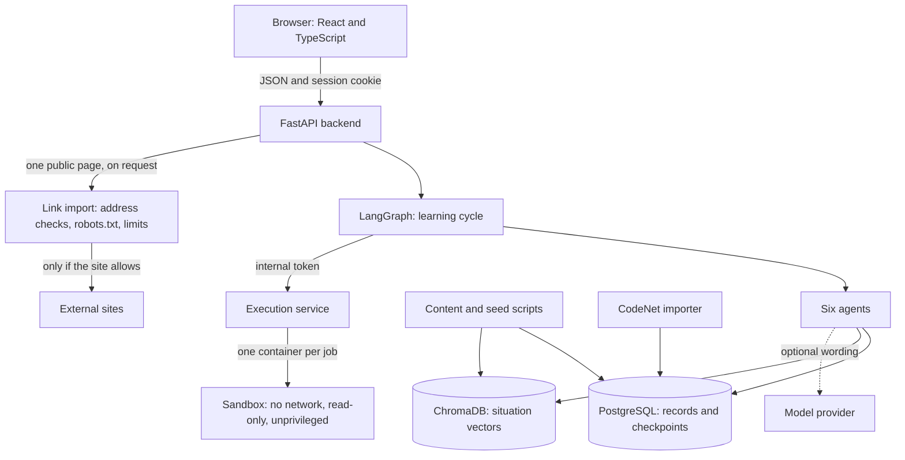
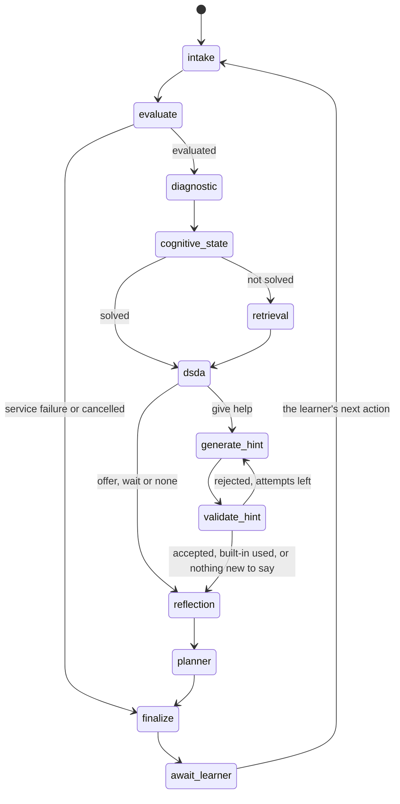
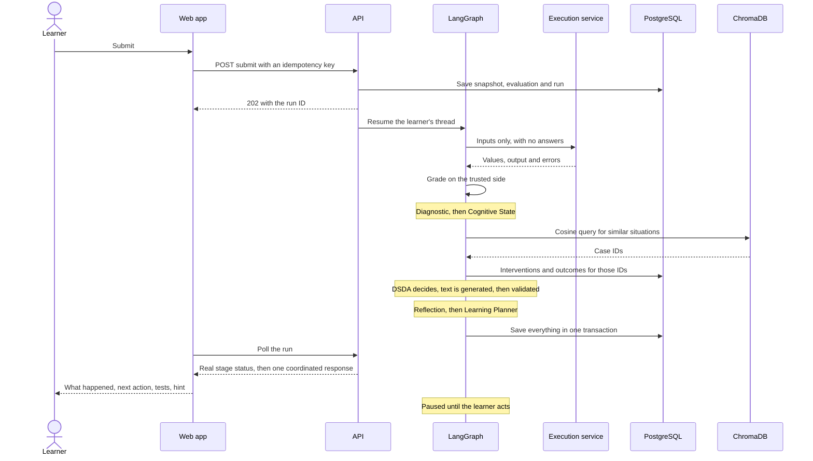
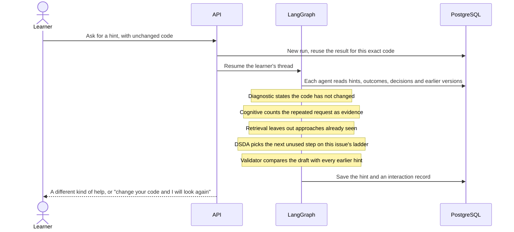
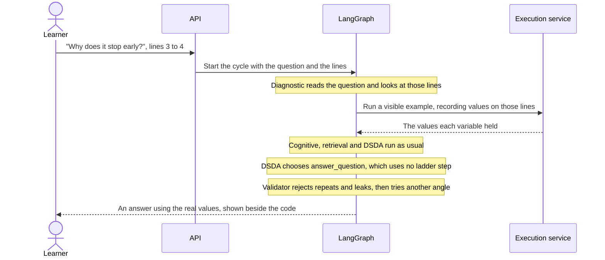

# Architecture

The report specifies the six agents and their order, LangGraph, PostgreSQL, ChromaDB, cosine similarity, a web platform and dashboards. Everything else in these diagrams is an implementation choice recorded in [decisions.md](decisions.md).

## Components



**Why grading is safe:** the sandbox receives test inputs and returns what the code produced. Expected answers stay in the backend, and comparison happens there. Student code therefore cannot read answers or claim a pass.

## The LangGraph state graph



There are two real cycles:

- **The learning cycle.** `await_learner` calls LangGraph's `interrupt`. The state is checkpointed in PostgreSQL per learner and problem, and nothing runs until the learner acts. The next action resumes the same thread. No loop can generate more detailed hints by itself.
- **The validation cycle.** A rejected draft is rewritten at the same level and strategy, at most 3 attempts, and then a built-in hint is used. If that would repeat an earlier hint, the next unused step is tried, or the tutor waits. A rewrite cannot raise the level of help.

The report calls processing "sequential" (§5.1, p.4) and also "cyclic" (§6.3, p.8). This design satisfies both: agents run in sequence within a cycle, and the cycle repeats with each learner action.

## One submission



## One repeated hint request



## One question about the code

The learner types what is confusing and can select lines in the editor. The request is `POST /problems/{id}/hint` with `question`, `focus_start` and `focus_end`, and it starts the same graph as any other hint.



Lesson examples use a separate route, `POST /playground/run`. It runs code in the same sandbox against a hidden scratch problem. It is never graded, starts no learning cycle, and does not count as work in progress.

## Event semantics

| Action | Runs | Graded? | Agents? | Changes mastery? |
|---|---|---|---|---|
| **Run** | Public examples, or the learner's own input | No | No | No |
| **Submit** | All enabled tests | Yes | All six | Yes |
| **Hint** | Public examples, or reuses the result for this exact code | No | All six | No |
| **Reflection answer** | Nothing | No | No | No. Stored as its own event. |
| Typing | Nothing. Autosave and a local parser only. | No | No | No |

## Ordering, duplicates and stale results

- Each result belongs to a code snapshot, and the response returns that code. If the editor has changed, the UI says the results are for an earlier version.
- An idempotency key makes a double click or retry the same attempt, enforced by a unique constraint.
- A per-learner queue applies actions in order, so an older result cannot overwrite newer state. The UI also follows only the newest request.

## Failure handling

| Failure | What the learner sees | What is recorded |
|---|---|---|
| Execution service down | "A problem on our side, not with your code", with Try again. Nothing is counted. | `evaluate` failed, later stages skipped with a reason. |
| Model provider down | A standard hint, labelled. | `generate_hint` status `fallback`, with provider metadata. |
| An agent crashes | The cycle completes with a safe default. | That stage `failed`, with error type. |
| Retrieval down or no match | Normal help, chosen without it. | Reason recorded. |
| Server restarts mid-run | Work marked failed, with a retry offered. | Recovered on startup. A fresh thread starts if a checkpoint is mid-cycle. |
| Connection lost when submitting | "Your code is safe", with Try again using the same key. | No duplicate. |
| A hint fails validation | A labelled standard hint, the next kind of help, or an honest wait. | `validate_hint` status `fallback`, with the violations, and a warning in the log. |
| A link cannot be read | What happened in plain words, and a route to paste with the link kept as the source. | Reason code in the response. |

## Repository layout

```text
backend/   FastAPI API, LangGraph, agents, policy.yaml, migrations, tests
runner/    Execution service, sandbox image and harness, tests
frontend/  React app, unit tests, Playwright end-to-end tests
content/   Units, problems, tests, reference solutions, topic lessons, knowledge checks
data/      Provenance notes and the importer's made-up test fixture
scripts/   Setup, development start, content verification, curriculum conversion, problem bank
docs/      This documentation
```
