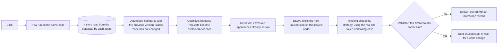

# Bug report: the tutor repeated the same hint

**Status:** fixed and verified. Tests: `backend/tests/test_repeated_hints.py`, plus browser tests in `frontend/e2e/learner.spec.ts`.

## Symptom

A learner with a syntax error pressed **Ask for a hint** repeatedly and got this every time:

> Python stopped reading at line 3 and reported: "invalid syntax". Read that line slowly, and also the line above it, since the mistake is often just before where Python notices it.

## Reproduction

Real PostgreSQL, real execution service, real LangGraph, no model. Five requests on unchanged code, recorded before the fix:

| Scenario | Distinct hints | Levels | Support score, every click | Hint outcomes in the database |
|---|---|---|---|---|
| Generic syntax error, the reported case | **1 of 5** | 2, 2, 2, 2, 2 | 0.208 | all `NULL` |
| Missing colon | **1 of 5** | 2, 2, 2, 2, 2 | 0.208 | all `NULL` |
| Off-by-one logic error | **1 of 5** | 1, 1, 1, 1, 1 | 0.208 | all `NULL` |
| Runtime error | **1 of 5** | 1, 1, 1, 1, 1 | 0.208 | all `NULL` |
| Timeout | **1 of 5** | 1, 1, 1, 1, 1 | 0.208 | all `NULL` |
| Syntax error after a submission, with **I need more help** | **1 of 4** | 2, 2, 2, 2 | 0.337 | all `NULL` |

Every click created a new `hints` row and a new idempotency key, which rules out the frontend, caching, and stale API responses.

## Exact root cause

Four separate defects combined. Fixing any one alone would not have fixed the bug.

| # | Defect | Where | Effect |
|---|---|---|---|
| 1 | **DSDA received identical inputs on every click.** Hint outcomes were only resolved on a *different* snapshot, and `repeat_count` excluded the same code. Both choices are right for measuring learning, but nothing else told DSDA the learner had asked again. `hints_on_issue` was computed and never used to choose help. | `nodes._resolve_hint_outcomes`, `nodes.diagnostic`, `dsda.need_score`, `dsda.decide` | The score and level could not change without a code change. |
| 2 | **Syntax help could not escalate.** `syntax_max_level: 2` clamped every syntax decision, including an explicit "more". | `policy.yaml`, `dsda.decide` | Syntax errors were stuck at level 2. |
| 3 | **Generation had no memory.** `built_in_hint(decision, diagnostic)` took no history, there was one template per (issue, level), and syntax had one template per issue regardless of level. The model prompt never saw earlier hints. | `hints.built_in_hint`, `hints._prompt` | The same inputs always produced the same text. |
| 4 | **Nothing compared a hint with earlier hints.** | `hints.validate_hint` | The final safety net could not catch a repeat. |

Checked and ruled out: frontend request and rendering, idempotency, API validation, database writes, caching. Re-running identical code is deliberately avoided, since the code is unchanged and so is its result. The diagnostic rules do re-run each time.

## Data flow

### Before

```mermaid
flowchart LR
    C[Click] --> R[New run on the same code]
    R --> E[Reused evaluation, correct]
    E --> D["Diagnostic: repeat_count stays 1"]
    D --> S["Cognitive: outcomes stay NULL, confusion unknown"]
    S --> P["DSDA: same score, same level, syntax capped at L2"]
    P --> H["built_in_hint: same issue and level, so the same template"]
    H --> V["Validator: no check against earlier hints"]
    V --> X[Identical hint, stored as a new row]
```

### After

## What changed

1. **Persisted interaction state.** A new `interaction_records` table holds one row per cycle: code version, trigger, verdict, issue, tests, diagnosis, cognitive estimates, retrieval result, the full DSDA decision, the hint, the learner's input, active time and policy version. `tutoring/history.py` reads it back, and each agent loads history fresh from the database. Earlier cycles were backfilled by the migration.
2. **DSDA separates need from what has been seen.** Each issue has an ordered ladder of different strategies in `policy.yaml`. A step used on an issue is not used again. See [dsda.md](dsda.md).
3. **Evidence-based text.** The second syntax hint quotes the real token and line: "Python's marker stops at `=` on line 3: `x = = 1`."
4. **Validator checks history.** New rejections: repeating an earlier hint, inventing line numbers or test results, contradicting the diagnosis, vague advice, and going off topic.
5. **An honest end state.** When every step for this version of the code has been shown, the tutor says so and waits, instead of repeating itself. The button locks until the code changes, and any change reopens help.

## After the fix

The same reported code, in the real browser UI, six clicks. The fifth step was added later, in `dsda-2.1`:

| Click | Strategy | Level | Text starts |
|---|---|---|---|
| 1 | `syntax_pinpoint` | 2 | Python stopped reading at line 3 and reported: "invalid syntax"... |
| 2 | `syntax_read_tokens` | 2 | Python's marker stops at `=` on line 3: `x = = 1`. Read that line one piece at a time... |
| 3 | `syntax_checklist` | 3 | 1. Write line 3 out by hand. 2. Check every bracket and quote is closed... |
| 4 | `syntax_analogous_line` | 4 | Here are correct lines of some common shapes, from a different task... |
| 5 | `syntax_exact_fix` | 4 | Names the exact problem on line 3 and what to do about it, without writing the function |
| 6 | none, waiting | 0 | You have seen all the help for this version of your code... Try this next... |

## Tests that reproduce the bug and prove the fix

All of these fail on the old code, because it returned one distinct hint.

| Test | Proves |
|---|---|
| `test_second_hint_on_unchanged_code_is_not_the_same_hint` | The critical regression from the brief: text and strategy differ, DSDA sees updated history, and the score rises |
| `test_the_exact_reported_hint_appears_at_most_once` | The reported text appears once, then the real token and line are used |
| `test_repeated_requests_never_show_the_same_hint` (6 kinds of error) | No repeats or near-repeats, and help never falls while nothing changes |
| `test_i_need_more_help_now_works_on_syntax_errors` | The syntax cap is gone |
| `test_when_every_step_is_used_the_tutor_waits_rather_than_repeating` | The honest end state stores no hint |
| `test_changing_the_code_reopens_help_after_waiting` | New code is new evidence |
| `test_model_that_repeats_itself_is_rejected_then_labelled_fallback_is_used` | The check also applies to model text, and fallbacks are labelled |
| Browser: "asking repeatedly gives different help each time, then the tutor waits for a change" | The complete path through the real UI |

## Deliberate changes to existing tests

These encoded the design that caused the bug, so they were changed rather than kept passing:

- `test_syntax_help_never_climbs_above_its_cap` became `test_syntax_help_climbs_one_step_at_a_time`.
- `test_repeated_logic_error_escalates_one_level_at_a_time` now also requires that no kind of help repeats.
- `test_worked_example_in_the_documentation_is_accurate` uses the new weights, and [dsda.md](dsda.md) was updated with it.
- `test_agents_receive_each_others_outputs` now expects the first hint to be `conceptual_question`. Strategy is now how help is framed, and the earlier value moved to `theme`.

## A follow-up report: help stopped too early, and asking did nothing

After the first fix, a learner reported that hints stopped, and that typing into "What are you stuck on?" and pressing "Ask for help" did nothing. Both were real defects.

| What the learner saw | Root cause | Fix |
|---|---|---|
| "Ask for help" did nothing after the last hint | `doHint` in `Workspace.tsx` refused every request while the tutor was waiting, including typed questions | The lock now applies only to a plain request. A question, selected lines or "this feels like a lot" always goes through. |
| The question was ignored even when it did run | The text was passed to the prompt only, and with no model configured nothing used it | `questions.py` reads the question, and the sandbox traces the lines it is about, so the rule-based answer uses real values |
| "That is 14 different hints" | The count included old duplicates, which were stored before the first fix | Counts distinct text. Old duplicates are hidden from "Earlier help". |
| Only four kinds of help, then it stopped | "I need more help" required a higher level each time, which jumped over `trace_failing_case` and `print_debugging`, and left `direct_pointer` out of reach | It now takes the next unused step in order. A separate test walks all seven. |
| A new question on the same lines was told "I have already answered that" | Each question built the same text, so the validator rejected it as a repeat | Each intent has its own answer and several other angles. The message appears only when all of them have been used, and it now says that is everything it can work out. |

Tests: `test_asking_for_more_help_never_jumps_over_a_kind_of_help`, `test_different_questions_on_the_same_lines_get_different_answers`, `test_the_same_question_again_gets_a_new_angle_before_any_refusal`, `test_a_question_on_solved_code_still_gets_an_answer`, and the browser test "after every hint has been shown, asking about selected lines still runs the agents and answers".

`test_help_never_falls_while_nothing_changes_even_after_a_skipped_step` was changed on purpose. It required the tutor to stop while unseen help remained. It is now `test_a_skipped_step_comes_back_before_waiting_but_never_a_conceptual_question`.

## A further report: hints that repeated the error rather than explaining it

A learner wrote `for i in count(n, n):` with no import. The tutor said "add `print(n, i)` before line 4", which could never run, because `i` does not exist before that line and the line itself fails.

| Cause | Fix |
|---|---|
| Every `NameError` shared one generic message | `error_analysis.py` works out the real cause from the code, the task and the examples |
| The print hint named the loop variable | `_probe` now names only values that already exist on that line |
| Tracing and print hints were offered for a line that cannot run | A missing name has its own ladder without them |
| The first syntax hint repeated Python's message | It now uses the real line and token |
| The validator accepted a hint that ignored the diagnosis | New rejections: `ignores_diagnosis`, `repeats_error_message`, `too_vague` |
| Help jumped ahead when retrieval suggested a later step | A request for more now walks in order |

Tests: `backend/tests/test_diagnosis.py`, and the browser test "a missing import gets its real cause, with help that becomes more specific".

Deliberate test change: `test_the_exact_reported_hint_appears_at_most_once` now requires the old generic text to be gone.

## Two further findings from this work

- **Retrieval almost never contributed.** Measured across 10,800 learner states, the old setup returned a reliable match in 0.15% of them. With 2,000 labelled synthetic cases and a wider candidate pool it is about 12%, and it still reports "no reliable match" for the rest.
- **Evidence could go stale after editing an imported question.** A hint reused an evaluation made with the old tests. Evaluations from before the question changed are no longer reused.

## Generic hints found by the agent audit (10 November)

Not repeated, but generic. [agent-audit.md](agent-audit.md) drove real scenarios through the stack and checked every hint shown.

| Before | Cause | After |
|---|---|---|
| "Your answers are very close to the expected ones. Does your loop include both its first and last values?" | The built-in wording for logic mistakes was a fixed sentence per issue. The diagnostic knew the failing call, the values and the loop, but the wording had no place for the loop. | "For `sum_to_n(3)` your function returned `3`, but `6` was expected. Does your loop, `for i in range(1, n):` on line 3, visit both the first and the last value it should?" |
| "Your function works something out. How does the code that called it get that result back?" | Same | "Your loop builds up `total`, but for `sum_to_n(3)` the caller received `None`. After the loop ends, how does the code that called your function get that result back?" |
| "Use a loop." and "Read the problem again." passed validation | "loop" counted as a specific word, and those phrases were not on the vague list | Both are rejected as `vague_advice`. Model text must also name a line, a value or a name from the learner's code. |
| The trace hint lost its question | Four sentences, against a limit of three at level 2 | Three sentences, ending with the question and saying what to watch for |

In the first audit run, 8 of 16 hints named nothing concrete. In the final run, every hint names the learner's code, a line or a value, and none uses generic advice. Tests: `backend/tests/test_hint_quality.py`.
